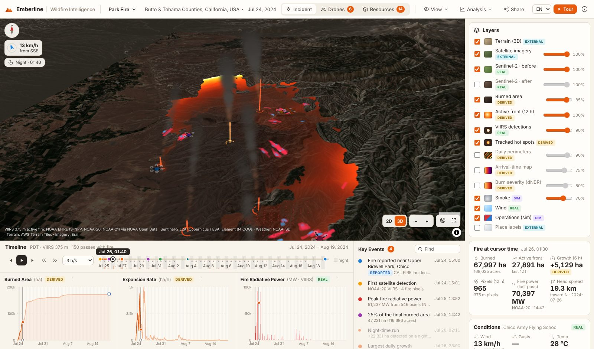
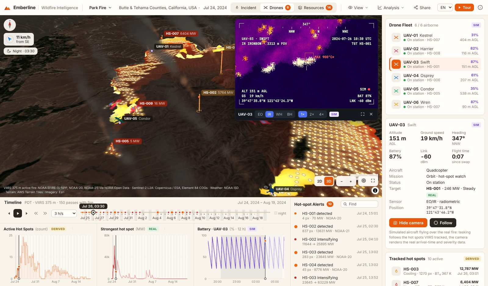
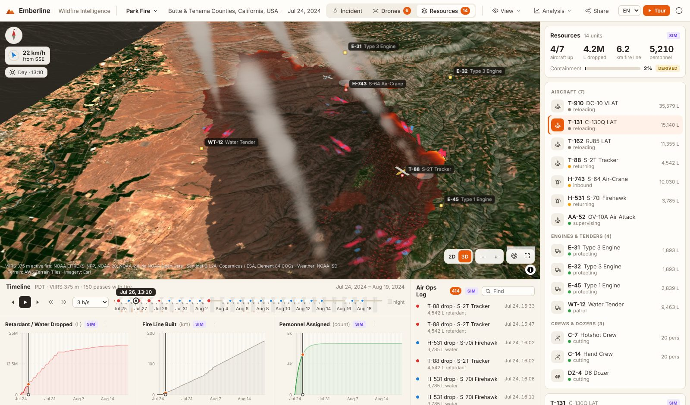
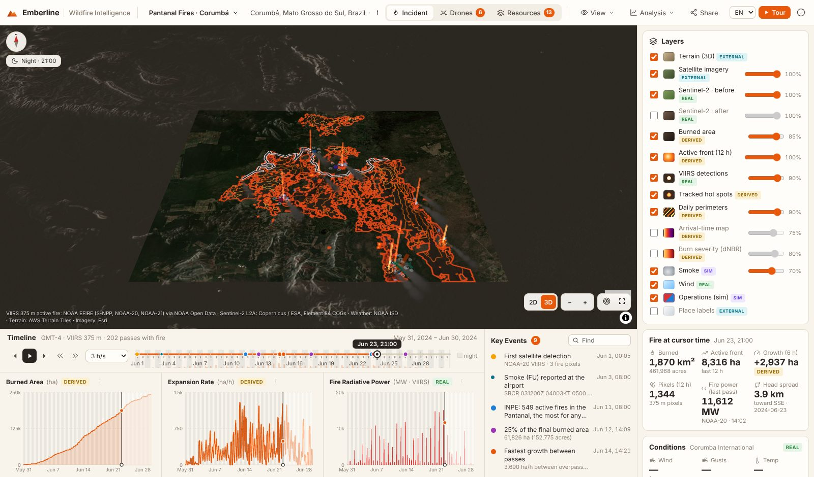
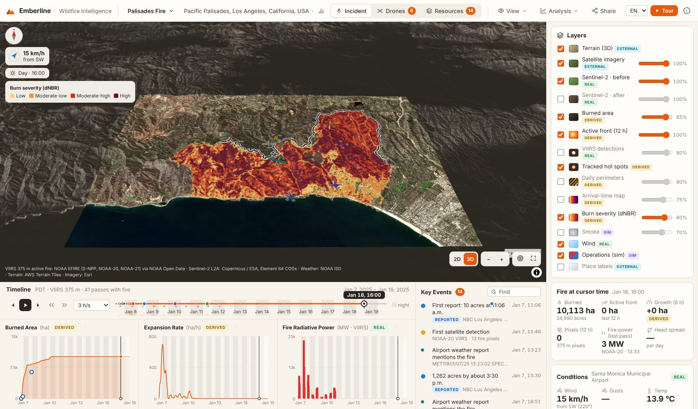

# Emberline: wildfire intelligence on a 3D map

**Watch a wildfire grow hour by hour, track its hot spots with a drone fleet and rehearse the firefighting response, all rebuilt from open satellite data.**



Emberline replays real wildfires. Every flame, hot spot and burn scar on the map comes from NASA/NOAA satellites and the Copernicus programme. Each number shows where it came from:

| Chip | Meaning |
|---|---|
| `REAL` | measured by a satellite or weather station |
| `DERIVED` | computed here from those measurements |
| `REPORTED` | published by an agency or the press, with a link |
| `EXTERNAL` | third-party map layer |
| `SIM` | simulated rehearsal (drones, aircraft, crews) |

It runs as a static site with no server, account or API key.

## Incidents

| | **Park Fire** (default) | **Pantanal fires · Corumbá** | **Palisades Fire** |
|---|---|---|---|
| Where / when | Butte & Tehama Counties, California · 24 Jul – 20 Aug 2024 | Mato Grosso do Sul, Brazil · June 2024 | Los Angeles, California · 7 – 20 Jan 2025 |
| VIIRS fire pixels | 23,026 on 150 overpasses | 32,826 on 202 overpasses | 3,655 on 41 overpasses |
| Burned area (derived) | **422,829 acres** | **243,258 ha** in a 1° × 0.85° window | **24,990 acres** |
| Check against reported | 429,603 acres (−1.6 %) | no official perimeter for this window | 23,448 acres (+6.6 %) |
| Weather station | Chico (KCIC) | Corumbá (SBCR) | Santa Monica (KSMO) |

<table><tr>
<td></td>
<td></td>
</tr><tr>
<td><b>Drones.</b> Six simulated UAVs are tasked at every satellite overpass to the hot spots VIIRS is tracking. The camera renders the real arrival-time and severity data as a thermal (Ironbow / White-hot / Black-hot) or EO image, with a HUD.</td>
<td><b>Resources.</b> Air tankers fly drop cycles in daylight from the real air base to the active front. Retardant and water lines stay on the ground. Crews and dozers build line from the heel of the fire. Containment follows reported values where they exist.</td>
</tr><tr>
<td></td>
<td></td>
</tr><tr>
<td><b>Pantanal, Brazil.</b> A month of wetland fires around Corumbá, with daily perimeters and hot spots.</td>
<td><b>Burn severity.</b> Sentinel-2 dNBR at 20 m for the Palisades Fire, shown on each pixel once it has burned on the timeline.</td>
</tr></table>

## What you can do

- **Scrub through time.** One timeline drives the map, charts, panels and camera. Nights are shaded and every satellite pass is marked. Use play at 30 min/s to 24 h/s, step event by event (`[` `]`) or pass by pass (`,` `.`).
- **Read the fire.** Layers:
  - The active front: everything that ignited in the last 12 h, glowing at the leading edge.
  - Char.
  - Individual 375 m VIIRS pixels, aged by colour.
  - Tracked hot-spot beacons.
  - Daily perimeters.
  - An arrival-time map (the classic progression map).
  - Burn severity.
  - Sentinel-2 before and after, with a slider.
  - Smoke that leans with the hourly observed wind.
  - Terrain lit by the real sun, darkening at night.
- **Hover the terrain** for elevation, the time each place burned, and its severity.
- **Charts** for burned area, expansion rate and fire radiative power per pass (Incident mode); active hot spots, strongest hot spot and drone battery (Drones mode); drops, fire line and personnel (Resources mode). Click a chart to jump to that moment, or download any chart as CSV.
- **Key events** are computed from the data:
  - first detection
  - peak fire power
  - fastest growth
  - night-time runs
  - area milestones
  - growth slowing
  - airport METARs mentioning the fire or smoke
  - reported facts with sources

  Hot-spot alerts and the Air Ops log have their own lists. Click any event to fly there.
- **Tour.** A guided story of each incident, from first detection through the run, peak power, drones, response, severity and before/after.
- **Live FIRMS.** Overlay near-real-time NASA FIRMS detections on the current view with your free MAP_KEY. Jump to open wildfires from NASA EONET.
- **Share.** Copy a link that opens the same instant, mode, selection, layers and camera.
- English, Português and Español; metric or imperial units; local time or UTC; light or dark theme. Works on phones.

Keyboard: `Space` play/pause · `←`/`→` one hour (`Shift`: one day) · `[`/`]` events · `,`/`.` passes · `1`/`2`/`3` modes · `R` reset view · `Esc` close.

## How it works

```
 OFFLINE, once per incident (Python, pipeline/)                    STATIC SITE (public/ + src/)
 NOAA EFIRE VIIRS 375 m (S-NPP, NOAA-20, NOAA-21) ─┐                React 19 · TypeScript · Vite · Zustand
 Sentinel-2 L2A COGs (pre / post)                  ├─▶ data/<id>/   MapLibre GL 5: 3D terrain, imagery, fire raster
 NOAA ISD hourly airport weather                   ┘   incident.json, arrival.png, three.js layer: aircraft, drones,
                                                       detections, hotspots, perimeters,  smoke, drop curtains, beacons
                                                       weather, s2_pre/post.jpg, severity Deterministic sims: drones, air ops
```

1. **When it burned** (`pipeline/fetch_viirs.py`). NOAA publishes the VIIRS I-band Enterprise Active Fire product (EFIRE) for all three VIIRS satellites on its open AWS buckets. For each day the fetcher:
   - lists the granules;
   - keeps those in the ~13:30 and ~01:30 local-solar overpass windows;
   - **range-reads only the first 32 KB** of each, which holds its footprint polygon;
   - downloads the few that cross the fire and extracts every fire pixel with its time, FRP and 4 µm brightness temperature.
2. **Where it burned** (`pipeline/sentinel2.py`). Pre- and post-fire Sentinel-2 L2A composites are built per pixel from the clearest scenes, read straight from COG overviews into a Web Mercator grid. The burn scar is dNBR = NBR<sub>pre</sub> − NBR<sub>post</sub> ≥ 0.1, kept within 1.5 km of VIIRS fire. Dry-season wetlands brown everywhere, so the Pantanal uses dNBR ≥ 0.27 and post-fire NBR ≤ 0.
3. **Arrival time** (`pipeline/build_incident.py`).
   - VIIRS footprints are painted on a 40–100 m grid and closed morphologically after every overpass.
   - New cells get a time between the previous look and the current one, in proportion to their distance from the previous burned area.
   - Burn-scar cells take the time of the nearest VIIRS cell.
   - The browser decodes the grid from a 16-bit PNG and paints any instant in one pass.
4. **Hot spots**. Each overpass's fire pixels are clustered (1.2 km) and linked across overpasses (4 km, 36 h) into tracks with a status: new, intensifying, steady or cooling.
5. **Weather** (`pipeline/weather.py`). Hourly wind, gusts, temperature and humidity come from the nearest airport in NOAA's ISD. METAR remarks such as `PACIFIC PALISADES FIRE FU NW-SW` become events.
6. **Simulated response** (`src/sim/`). This part is pure functions of time, so scrubbing in either direction is exact:
   - Drones are tasked at each overpass to the live edge of the strongest hot spots.
   - Aircraft fly event-scheduled drop cycles in daylight.
   - Ground units ride the perimeter.
   - Containment is anchored to reported numbers where they exist.

The deriving and simulating steps are open, and the in-app *Methods & sources* panel shows each one for the incident you are looking at.

## Run it

```bash
npm install
npm run dev        # http://localhost:5173
npm run build      # → dist/ (relative paths: works on GitHub Pages, Vercel or any static host)
```

The incident packages are committed in `public/data/`, so the app needs nothing else. Basemap imagery (Esri) and terrain (AWS Terrain Tiles) load from public tile servers. If imagery is blocked, the bundled Sentinel-2 images still cover each fire.

**Deploy.**
- **GitHub Pages:** `.github/workflows/pages.yml` publishes `dist/` on every push to `main`. Enable it under *Settings → Pages → Source: GitHub Actions*.
- **Vercel:** `vercel.json` is included.

## Rebuild the data, or add a fire

Python ≥ 3.11:

```bash
pip install -r pipeline/requirements.txt
WILDFIRE_RAW=/tmp/raw bash pipeline/run_all.sh     # ≈15 min, downloads ~2 GB, no accounts or keys
```

To add an incident, add an entry to `pipeline/incidents.py`:
- bbox
- UTC window
- time zone
- origin (optional)
- nearest ISD station
- Sentinel-2 before/after windows
- air base
- reported facts with sources

Then run the steps for it:

```bash
python -m pipeline.fetch_viirs <id>
python -m pipeline.build_incident <id> --res 80
python -m pipeline.sentinel2 <id>
python -m pipeline.build_incident <id> --res 80     # second pass: refine with the burn scar
python -m pipeline.weather <id>
python -m pipeline.make_index
```

EFIRE coverage on AWS starts in February 2024.

## Tests

```bash
npm test                         # pipeline unit tests (pytest)
npm run typecheck
npm run build && npx vite preview --port 4173 &
npm i --no-save playwright && npx playwright install chromium
npm run smoke                    # opens every incident in Chromium, walks the 3 modes, checks layers and errors
npm run e2e                      # drives every control (26 checks): timeline, keyboard, layers, menus, camera,
                                 # share links, languages, tour, incident picker, mobile layout
```

CI (`.github/workflows/ci.yml`) runs the typecheck, the build and the pipeline tests on every push.

## Limits

- **This is an exploratory analysis and training tool**, not an operational fire-spread prediction or incident-management system.
- Up to six overpasses a day look at a fire. Timing between them is interpolated, and the first detection is not the ignition.
- VIIRS pixels are 375 m (larger at the edge of the swath), and very hot fires light up neighbouring pixels. That is why the final footprint comes from Sentinel-2 rather than VIIRS alone; VIIRS alone overestimates the Palisades Fire by about 80 %.
- Sentinel-2 composites can miss small areas under persistent cloud or smoke; VIIRS fills them.
- The weather is one airport station, which can be tens of kilometres from the fire.
- **Drones, aircraft, crews, drops, fire line, personnel and the thermal camera are simulated.** The thermal temperatures are illustrative. Containment is interpolated between reported values (Park, Palisades) or simulated (Pantanal).

## Credits and licences

**Code:** MIT ([LICENSE](LICENSE)).

**Data:**
- NOAA JPSS VIIRS Enterprise Active Fire (EFIRE), NOAA Open Data Dissemination: public domain.
- Contains modified Copernicus Sentinel data (2024–2025); Sentinel-2 L2A COGs by Element 84 on AWS.
- NOAA NCEI Integrated Surface Database: public domain.
- AWS Terrain Tiles (Mapzen terrarium; SRTM, USGS 3DEP and others).
- Basemap imagery and labels © Esri and its partners.
- Reported facts link to their sources in the app: CAL FIRE, InciWeb, NASA Earth Observatory, Mongabay, NBC Los Angeles, NSPR, City of Malibu, Wikipedia.
